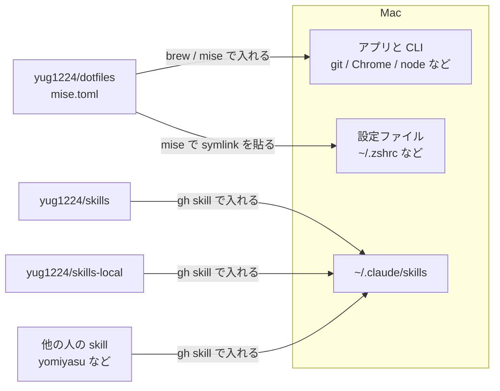
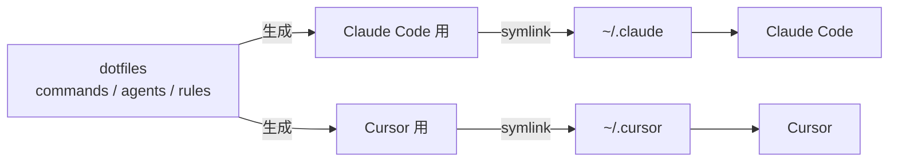
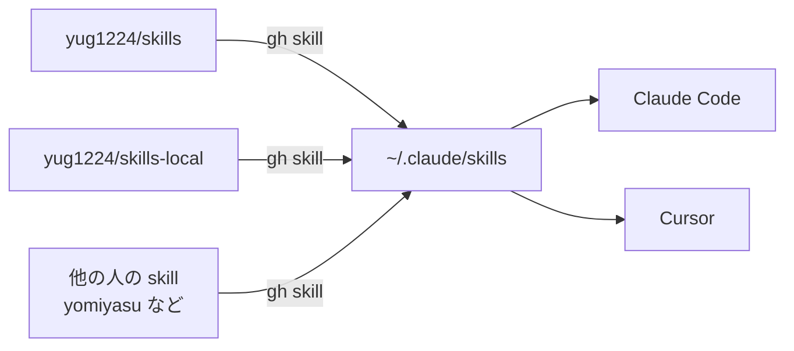
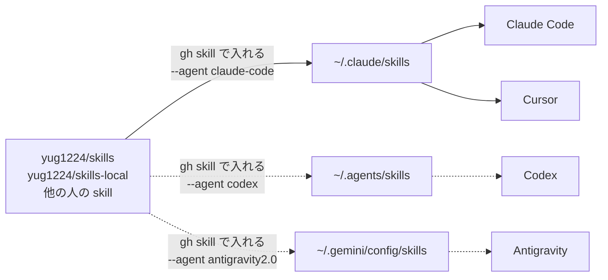

## はじめに

こんにちは。ぷーじ（[@yug1224](https://x.com/yug1224)）です。

Mac の開発環境は dotfiles で管理していて、Homebrew のパッケージ、言語や CLI のツール、設定ファイルの symlink まで mise で入れています。新しい Mac でも `make install` を 1 回実行すれば、ほぼ元の環境に戻ります（2 回目以降の入れ直しは `make mise`）。

その dotfiles の中で、Claude Code と Cursor 用の skill（`SKILL.md` に手順や規約を書き、AI が必要なときに読み込む Agent Skills）や rules がどんどん増えていました。公開リポジトリに会社固有の規約を混ぜたくないうえに、ツールごとの設定ファイルを生成するスクリプトも面倒になってきたので、skill を別のリポジトリに切り出し、mise から `gh skill` で入れるようにしました。

この記事では mise・dotfiles・skill をどう組み合わせて環境を組んでいるかと、skill の入れ方を決めるまでに試したことを紹介します。

## 全体像

使っているリポジトリは 3 つです。

| リポジトリ                                                      | 置いているもの                                                                  |
| --------------------------------------------------------------- | ------------------------------------------------------------------------------- |
| [yug1224/dotfiles](https://github.com/yug1224/dotfiles)（公開） | `mise.toml`、各ツールの設定ファイル、常に読み込む AI の指示（`CLAUDE.md` など） |
| [yug1224/skills](https://github.com/yug1224/skills)（公開）     | 公開してよい skill 16 個                                                        |
| yug1224/skills-local（ローカルのみ）                            | 手元だけで使う skill 4 個（GitHub には push しない）                            |

新しい Mac では `make install` で Homebrew と mise 本体を入れ、そのまま 1 回目の `mise bootstrap` まで実行します。2 回目以降は `make mise`（`mise bootstrap --skip-dirty`）で入れ直します。何がどこに入るかを図にすると次のとおりです。



どれも dotfiles の中に書いてあり、`make mise` を 1 回実行すれば全部入ります。書いている場所はほとんどが `mise.toml` で、ツールだけはそこから貼る `config.toml`、skills-local は Git の管理外の `mise.local.toml` です。skill だけは 3 か所から集めて、`~/.claude/skills` 1 か所にまとめています。

## dotfiles を mise で管理する

mise の `bootstrap` と `dotfiles` は 2026 年 7 月の v2026.7.4 で experimental を外れました。今は experimental の設定を有効にしなくても使えます。

https://mise.jdx.dev/bootstrap.html

### 入れるものと置き場所

`mise.toml` には入れるものと置き場所をまとめて書いています（抜粋）。

```toml:mise.toml
# これより古い mise では実行させない
min_version = { hard = "2026.7.7" }

[settings]
dotfiles.root = "~/.dotfiles"
dotfiles.default_mode = "symlink"

[bootstrap.brew.taps]
"cloudflare/cloudflare" = "https://github.com/cloudflare/homebrew-cloudflare.git"

[bootstrap.packages]
"brew:git" = "latest"
"brew:tig" = "latest"
"brew-cask:google-chrome" = "latest"

[bootstrap.repos]
"~/Workspaces/yug1224/skills" = { url = "https://github.com/yug1224/skills.git" }

[dotfiles]
"~/.zshrc" = { source = "packages/zsh/.zshrc", mode = "symlink" }
"~/.config/git/config" = { source = "packages/git/config", mode = "symlink" }
"~/.config/mise/config.toml" = { source = "packages/mise/config.toml", mode = "symlink" }
# 同じ settings.json を VS Code と Cursor の両方に貼る
"~/Library/Application Support/Code/User/settings.json" = { source = "packages/code/settings.json", mode = "symlink" }
"~/Library/Application Support/Cursor/User/settings.json" = { source = "packages/code/settings.json", mode = "symlink" }
```

### 言語と CLI のツール

`[tools]` は `packages/mise/config.toml` に分けて、上の `[dotfiles]` で `~/.config/mise/config.toml` に貼っています。こうしておくと、どのディレクトリからでも同じツールが使えます。

```toml:packages/mise/config.toml
# tool_update.global_auto を使うので、古い mise では警告を出す
min_version = { soft = "2026.10.9" }

[tools]
node = "24"
pnpm = "latest"
gh = "latest"
jq = "latest"
claude-code = "latest"
"npm:oxlint" = "latest"
"npm:oxfmt" = "latest"

[settings]
# 2026.10.7 以降。グローバルのツールを定期的に自動で更新する
tool_update.global_auto = true
```

### 宣言で書けない手順

mise には `mise.toml` の `[tasks.<名前>]` にシェルのスクリプトを書いておき、`mise run <名前>` で実行できるタスクの機能があります。

https://mise.jdx.dev/tasks/

`bootstrap` という名前のタスクは、`mise bootstrap` が宣言した部分を入れ終えたあとに実行されます。そこで、宣言で書けない手順（mise でうまく入らない cask や、Claude Code のプラグインの更新など）は `[tasks.bootstrap]` に書いています。skill の入れ直しもここから `skills:update` という別のタスクとして呼ぶ構成です（抜粋）。

```toml:mise.toml
[tasks.bootstrap]
run = """
#!/usr/bin/env bash
set -euo pipefail

# cask などを入れる手順は省略

echo "bootstrap: ensure agent skills"
if ! command -v gh >/dev/null 2>&1; then
  echo "bootstrap: gh not found; skip agent skills (rerun: make mise)" >&2
elif ! mise run skills:update; then
  echo "bootstrap: agent skills install failed; continue (fix and rerun: make mise)" >&2
fi

echo "bootstrap: ensure Claude Code plugins"
if ! command -v claude >/dev/null 2>&1; then
  echo "bootstrap: claude not found; skip plugins (rerun: make mise)" >&2
elif ! mise run plugins:update; then
  echo "bootstrap: plugins update failed; continue (fix and rerun: make mise)" >&2
fi
"""
```

skill とプラグインの手順は失敗しても後ろの手順を続けるようにしています。失敗した原因を直したら、もう一度 `make mise` を実行すれば入ります。

### 何度でも実行できるようにする

宣言した部分はすでに合っていれば何もしません。ただし `[tasks.bootstrap]` は毎回実行されるので、何度実行しても同じ結果になるように書いておきます。

`[bootstrap.repos]` は、clone 済みのリポジトリに commit していない変更があると失敗します。skills のリポジトリは編集途中のことが多いので、`make mise` では `--skip-dirty` を付けて、そのリポジトリだけ飛ばすようにしました。

また、clone 済みのリポジトリは pull しないので、`skills:update` は手元の作業ツリーにある skill をそのまま入れます。別の Mac で直して push した skill を入れたいときは、先に `git pull` しておきます。

## skill を別のリポジトリに切り出した

以前は skill も dotfiles の中に置き、共通の commands / agents / rules から Claude Code 用と Cursor 用のファイルをスクリプトで生成して、symlink で配っていました。



この形だと、生成するスクリプトと、生成物がずれていないかを確かめるスクリプトが増え続けます。会社固有の規約も Git の管理外のファイルで dotfiles に混ぜていて、公開してよいものとの境界があいまいでした。

切り出したあとは、生成するスクリプトが要らなくなり、`gh skill` で 1 か所に集めるだけになりました。



dotfiles に残したのは、常に読み込む指示（`CLAUDE.md` と Cursor の `kernel.mdc`）と、skill を入れる mise のタスクだけです。

ツールごとのファイルを生成しなくてよくなったのは、Cursor が `~/.claude/skills/` も読むからです。Cursor のドキュメントにも「For compatibility, Cursor also loads skills from Claude and Codex directories」と書かれています。

https://cursor.com/docs/context/skills

skill を入れるのには `gh skill` を使っています。GitHub CLI に入った、Agent Skills を入れたり公開したりするためのコマンドです。この記事を書いた時点（gh 2.104.0）ではまだ preview で、仕様は変わる可能性があります。

https://cli.github.com/manual/gh_skill

`gh skill install` は Claude Code や Cursor のほかに、Codex や Antigravity など 40 以上のエージェントに対応しています。ほかの AI を使いたくなったら、`gh skill` で入れる先を増やせば、同じ skill をそのまま使えます。



点線はほかの AI を足すときに増える入れ先です。元のリポジトリは同じままで、`gh skill install` に `--scope user` を付けて `--agent` を変えると、それぞれの入れ先に入ります。

ただし、そのまま入れると次の節で書く「元で消したものが入れた先に残る」問題が起きます。入れ先を足すときも、あとで紹介する `skills:update` と同じく、`--dir` で作業用の場所に全部入れてから図の入れ先と入れ替える想定です（`--dir` を付けると `--agent` と `--scope` は使われません）。どのディレクトリを読むかは、Codex と Antigravity のドキュメントに書かれています。

https://learn.chatgpt.com/docs/build-skills

https://antigravity.google/docs/skills

## 消した skill をどう片付けるか

`gh skill` で入れるようにしてから困ったのが、元のリポジトリで消したものの扱いです。`gh skill install` は symlink ではなくファイルをコピーして入れるので、元で消しても、入れた先には残ってしまいます。ここからは、この問題に対して試した 3 つの入れ方を順に紹介します。

### `gh skill install --force` で上書きする

最初はこの形でした。困ったのは、元のリポジトリで消したファイルが、`--force` で入れ直しても残ることです。使い捨てのリポジトリで、skill の中のファイルを 1 つ消して入れ直したところ、インストール先には残ったままでした。

skill の中のファイルなら、入れる前にその skill のディレクトリを消せば済みます。ただ、skill を丸ごと消したり名前を変えたりすると、古いディレクトリが残ります。

なお、手元のディレクトリから入れたもの（`--from-local`）は `gh skill update` の対象になりません。実行すると「has no GitHub metadata」と出て飛ばされます。

### mise の `symlink-each` で貼る

コピーだから残るのなら、symlink にすればよいのでは、と考えて試したのがこの形です。mise の `[dotfiles]` には `symlink-each` というモードがあります。ディレクトリの中のファイルを 1 つずつ symlink で貼り、元で消したファイルは次に `mise dotfiles apply`（`make mise` の中でも実行されます）で貼り直したときに symlink も消してくれます。

```toml
[dotfiles]
"~/.claude/skills" = { source = "~/Workspaces/yug1224/skills/skills", mode = "symlink-each" }
```

使い捨てのディレクトリで試すと、自分の skill は編集すればすぐ反映され（新しく足したファイルは次の `mise dotfiles apply` で入ります）、元で消したファイルの symlink も消えました。ただし、他の人が公開している skill も同じ形で入れるには、そのリポジトリを clone して、新しいバージョンが出るたびに自分で上げる必要があります。自分の skill と他の人の skill で管理の仕方が分かれるのも気になって、採用しませんでした。

### 別の場所に全部入れて入れ替える

そこで `gh skill` は使ったまま、消したものが残らないようにしたのがこの形です。`gh skill install` の `--dir` で作業用のディレクトリに全部入れ、全部成功したら `~/.claude/skills` と入れ替えます。

毎回まっさらな状態から作るので、消したファイルも丸ごと消した skill も名前を変えた skill も、次の実行で片付きます。他の人の skill はバージョンを固定していないので、入れ直すたびにその時点の最新リリース（リリースが無ければ既定ブランチの最新）になります。

試しに skill を 1 つリポジトリから外して実行すると、`~/.claude/skills` は 22 個から 21 個になりました。また、`gh` が途中で失敗するようにして実行すると、タスクは失敗し、`~/.claude/skills` は元の 21 個のままでした。入れ替えるのは全部入れ終わってからなので、`gh skill install` の途中で失敗しても、今の skill はそのまま残ります。

`~/.claude/skills` に手で置いたものも消えてしまうので、そこは割り切りです。入れたいものは全部 `mise.toml` へ書くことにしました。

### 3 つを比べると

試した 3 つを並べると、次のとおりです。

|                                           | `--force` で上書き           | `symlink-each`                   | 作り直して入れ替える         |
| ----------------------------------------- | ---------------------------- | -------------------------------- | ---------------------------- |
| 自分の skill の変更を反映するには         | ○ `skills:update` を実行する | ○ 編集はすぐ反映される           | ○ `skills:update` を実行する |
| 他の人の skill を最新にするには           | ○ `skills:update` を実行する | × 自分で clone を更新する        | ○ `skills:update` を実行する |
| 元で消したファイルや skill を片付けるには | × 手で消す                   | ○ `mise dotfiles apply` で消える | ○ `skills:update` で消える   |

自分の skill を直したときにすぐ反映されないのは不便ですが、`make mise` か `mise run skills:update` を 1 回実行すれば済みます。それよりも自分の skill と他の人の skill を同じ `gh skill` で扱えて、消したものも片付くことを優先しました。

## skill を作り直すタスク

`gh skill install` は GitHub のリポジトリと手元のリポジトリのどちらからでも skill を入れられます。このタスクでは他の人の skill を公開リポジトリから、yug1224/skills と yug1224/skills-local を手元のディレクトリから（`--from-local`）入れています。

### 公開している skill と他の人の skill

`skills:update` は `make mise` の `[tasks.bootstrap]` から呼ばれます。手で直した skill を反映したいときは、`mise run skills:update` だけを実行します。

```toml:mise.toml
[tasks."skills:update"]
run = """
#!/usr/bin/env bash
set -euo pipefail
dest="$HOME/.claude/skills"
mkdir -p "$HOME/.claude"
# mv で入れ替えるので同じファイルシステムに作る
staging="$(mktemp -d "$HOME/.claude/skills.staging.XXXXXX")"
trap 'rm -rf "$staging"' EXIT
gh skill install ~/Workspaces/yug1224/skills --from-local --all --dir "$staging" --force
gh skill install nanaism/yomiyasu yomiyasu --dir "$staging" --force
gh skill install GoogleChrome/modern-web-guidance modern-web-guidance --dir "$staging" --force
if mise tasks info skills:update:local >/dev/null 2>&1; then
  SKILLS_DIR="$staging" mise run skills:update:local
fi
old="$dest.old.$$"
if [[ -e "$dest" || -L "$dest" ]]; then
  mv "$dest" "$old"
fi
mv "$staging" "$dest"
rm -rf "$old"
"""
```

GitHub で公開されている skill を足したいときは、`gh skill install` の行を 1 行足します。リポジトリの skill を全部入れるなら skill 名の代わりに `--all` を、バージョンを固定したいなら `--pin <タグ>` を付けます。入れるのをやめたいときも、その行を消して `skills:update` を実行すれば古い skill も消えるので、ほかに作業はいりません。

```bash
gh skill install <owner/repo> <skill 名> --dir "$staging" --force
```

途中の `skills:update:local` は次の公開したくない skill を入れるためのタスクです。

### 公開したくない skill

GitHub に push せず手元だけで使う skill は、yug1224/skills-local に置いています。このマシンにしか無いリポジトリなので、公開している dotfiles の `mise.toml` には書きたくありません。

mise は `mise.toml` と同じディレクトリにある `mise.local.toml` も読み込みます。そこで dotfiles の `.gitignore` に `mise.local.toml` を足して Git の管理から外し、このファイルにタスクを書いています。

```toml:mise.local.toml
[tasks."skills:update:local"]
run = """
#!/usr/bin/env bash
set -euo pipefail
dir="${SKILLS_DIR:?run via: mise run skills:update}"
gh skill install ~/Workspaces/yug1224/skills-local --from-local --all --dir "$dir" --force
"""
```

会社の org などにある非公開リポジトリの skill を入れるときも、このタスクへ 1 行足す形にできます（非公開リポジトリに skill を置いて入れるところまではまだ試していません）。公開している `mise.toml` に書くと、リポジトリ名が見えるうえに、そのリポジトリを読めないマシンでは `gh skill install` が失敗して `skills:update` 全体が止まります。`gh skill` は `gh` でログインしているアカウントで GitHub にアクセスするので、そのアカウントが読める非公開リポジトリも対象です。

```bash
gh skill install <org/repo> <skill 名> --dir "$dir" --force
```

`mise.local.toml` が無いマシンでは、公開している skill と他の人の skill だけが入ります。

## おわりに

今回たどり着いた mise・dotfiles・skill の組み合わせ方は次のとおりです。

- brew、clone するリポジトリ、symlink は `mise.toml` に、ツールは symlink で貼る `config.toml` に宣言する
- skill だけは別のリポジトリに切り出し、`gh skill` で毎回作り直して入れ替える
- 公開したくない skill（ローカルの skill や非公開リポジトリの skill）は、`mise.local.toml` から同じ場所に入れる

`gh skill` はまだ preview なので、正式版になったら入れ方を見直すかもしれません。
