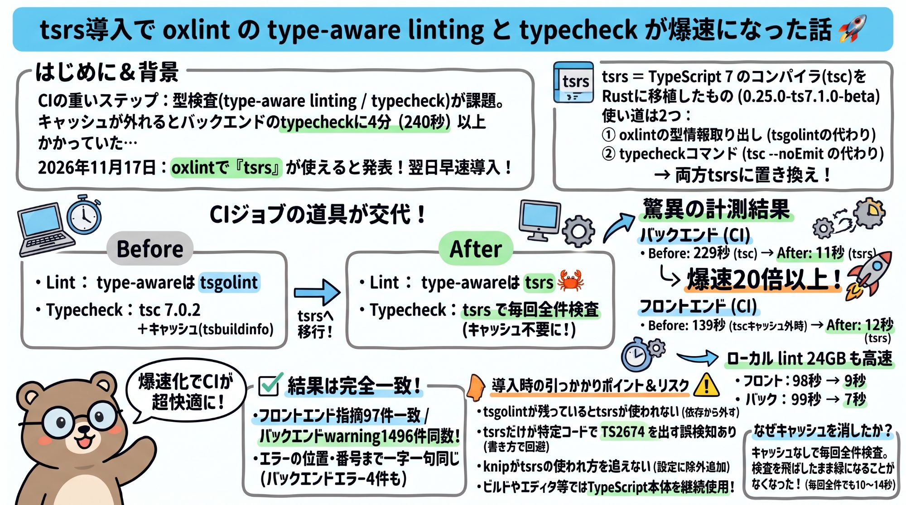
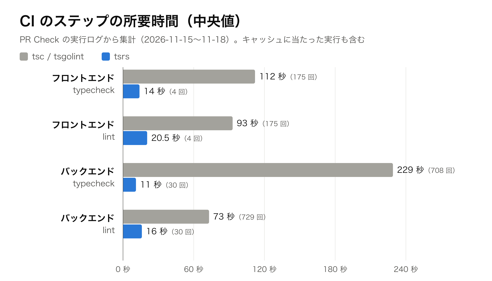

## はじめに

こんにちは。ぷーじ（[@yug1224](https://x.com/yug1224)）です。

以前の記事で、フロントエンドとバックエンドに oxlint、oxfmt、tsgo を入れた話を書きました。

https://zenn.dev/dress_code/articles/d655cd7a43b936

その後も type-aware linting と typecheck は CI の中で重いステップのままで、キャッシュが外れるとバックエンドの typecheck だけで 4 分以上かかっていました。

2026 年 11 月 17 日に、oxlint の type-aware linting で tsrs を使えるようになったと Oxc のブログで発表されたので、翌日にフロントエンドとバックエンドの両方へ入れました。この記事では、何をどう置き換えたか、どれくらい速くなったか、入れるときに引っかかったところを書きます。

## tsrs とは

tsrs は TypeScript 7 のコンパイラ（tsc）を Rust に移植したものです。npm では `tsrs` という名前で公開されていて、今回入れた `0.25.0-ts7.1.0-beta` は TypeScript 7.1 beta に準拠しています。

https://oxc.rs/blog/2026-11-17-faster-type-aware-linting-with-tsrs

https://github.com/oxc-project/tsrs

使い道は 2 つあります。

- oxlint の type-aware linting（`typeAware` / `typeCheck`）で、型の情報を取り出す道具として使う。oxlint-tsgolint の代わりになる
- `tsc --noEmit` と同じように、typecheck のコマンドとして使う

今回はこの 2 つを両方とも tsrs に替えました。

## Before / After

### 構成の変化

CI の各ジョブで、type-aware linting と typecheck を担う道具が tsgolint と tsc から tsrs に替わりました。ジョブ名と必須チェックは変えていません。

| CI のジョブ       | Before                              | After                      |
| ----------------- | ----------------------------------- | -------------------------- |
| Lint（必須）      | type-aware linting は tsgolint      | type-aware linting は tsrs |
| Typecheck（必須） | tsc 7.0.2、tsbuildinfo をキャッシュ | tsrs、毎回全件を検査       |
| Build             | TypeScript 本体                     | 変更なし                   |

### 計測結果

フロントエンドの計測結果です。ローカルの値はアプリ 1 つ分です。

|                                                    | tsgolint / tsc | tsrs           |
| -------------------------------------------------- | -------------- | -------------- |
| lint（ローカル）                                   | 98 秒 / 7.2GB  | 9 秒 / 4.6GB   |
| lint（CI のステップ）                              | 89 秒          | 25 秒          |
| typecheck（ローカル、コールド）                    | 54 秒 / 6.9GB  | 6.7 秒 / 4.0GB |
| typecheck（CI のステップ、キャッシュが外れたとき） | 139 秒         | 12 秒          |

バックエンドの計測結果です。

|                                                    | tsgolint / tsc | tsrs           |
| -------------------------------------------------- | -------------- | -------------- |
| lint（ローカル）                                   | 99 秒 / 9.6GB  | 7 秒 / 7.9GB   |
| lint（CI のステップ）                              | 95 秒          | 16 秒          |
| typecheck（ローカル、コールド）                    | 103 秒 / 6.6GB | 5.8 秒 / 6.6GB |
| typecheck（CI のステップ、キャッシュが外れたとき） | 276 秒         | 11 秒          |

ローカルの値は Mac（メモリ 24GB）で測りました。tsc は `--checkers 1` で動かしています。CI の typecheck の値は後で書くとおり tsc と tsrs を並べて走らせていたときのものです。CI の lint の tsgolint 側の値は、置き換える直前の別の PR の実行から取りました。

メモリの減り方は速さほどそろっていません。フロントエンドは lint・typecheck とも 3〜4 割減りましたが、バックエンドの typecheck は tsc も tsrs も peak RSS が 6.6GB で変わりませんでした。

### CI の実行ログで見ると

上の表は 1 回ずつ測った値です。置き換える前後の PR Check の実行ログからも、typecheck と lint のステップの所要時間を集めました。期間は 2026 年 11 月 15 日から 18 日で、tsrs を入れた PR 自体の実行は除いています。



- バックエンドの typecheck は、中央値が 229 秒（708 回）から 11 秒（30 回）になった。tsrs の 30 回はすべて 10〜12 秒に収まっている
- tsc の typecheck はキャッシュに当たった実行も含めた値。キャッシュに当たったとみられる 60 秒未満の実行は、フロントエンドで 175 回中 6 回、バックエンドで 708 回中 159 回しかなかった
- フロントエンドは置き換えてからの実行がまだ 4 回なので、tsrs 側の値は参考程度に見てほしい

バックエンドの typecheck は 20 倍以上速くなっていて、グラフにすると灰色の棒と青い棒の差がすごいことになりました。めちゃくちゃ爆速になって嬉しいです！

### 結果は一致した

速くなっても、指摘が変わってしまっては置き換えられません。lint と typecheck の結果を、tsgolint・tsc のときと比べました。

- フロントエンドの lint は、指摘 97 件がすべて一致した
- バックエンドの lint は、warning が 1496 件で同じだった
- typecheck のエラーは、フロントエンドはどちらも 0 件、バックエンドは 4 件がファイル・位置・エラー番号まで一致した

エラーの表示も変わりません。同じ型エラーを tsc 7.0.2 と tsrs で出すと、CI の出力（`a.ts(1,7): error TS2322: ...`）も `--pretty` の出力も一字一句同じでした。違うのは失敗したときの終了コードだけで、tsc は 1、tsrs は 2 を返します。どちらも 0 以外なので、CI の判定は変わりません。

## tsc と並べて走らせてから置き換えた

tsrs はまだ beta なので、いきなり tsc を外すのはやめて 2 段階に分けました。

1. 必須にしない `Typecheck (tsrs)` ジョブを CI に足し、tsc の `Typecheck` と同じ runner で並べて走らせる
2. 結果が合うのを確かめてから、`typecheck` の script を tsrs に替え、typecheck 用に入れていた TypeScript 7.0.2 を依存から外す

1 段目ではジョブ名を必須チェックの `Typecheck` と分けました。tsrs が誤検知しても PR のマージを止めないためです。同じ runner にそろえたので、所要時間もそのまま比べられました。

type-aware linting の入れ替えは、tsrs を足して oxlint-tsgolint を外すだけです。oxlint は 1.93.0 で動かしています。

```bash
pnpm add -D tsrs
pnpm remove oxlint-tsgolint
```

フロントエンドは pnpm workspace のモノレポなので、ルートに入れるときは `-w` を付けています。

oxlint の設定は tsgolint のときから変えていません。

```ts:oxlint.config.ts
import { defineConfig } from 'oxlint';

export default defineConfig({
  options: {
    typeAware: true, // type-aware linting の型情報は tsrs から得る
    typeCheck: true, // 型エラーも oxlint の結果として出す
  },
});
```

フロントエンドのアプリの `typecheck` は次のように替えました。tsc の `--checkers 1` は外し、tsrs の既定の checker 数で動かしています。tsrs はルートの devDependencies に入れています。

```diff json:package.json
-    "typecheck": "node ./node_modules/typescript7/bin/tsc --noEmit --incremental --diagnostics --checkers 1 -p tsconfig.typecheck.json",
+    "typecheck": "tsrs --noEmit --incremental --diagnostics -p tsconfig.typecheck.json",
```

## 入れるときに引っかかったところ

### tsgolint が残っていると tsrs が使われない

私たちの環境（oxlint 1.93.0）では、oxlint-tsgolint と tsrs が両方入っていると、oxlint は tsgolint のほうを使いました。tsrs を足すだけでは切り替わらないので、tsgolint は依存から外しています。

### TypeScript 7.1 で TS2674 になるコードがあった

バックエンドで、tsc 7.0.2 は通すのに tsrs は TS2674 を出す箇所が 1 つありました。関数が返す無名クラス式の static メソッドから、親クラスの protected constructor を `new this()` で呼ぶ形です。簡略化すると次のようなコードです。

```ts
abstract class BaseEvent {
  protected constructor(readonly payload: string) {}
}

function eventOf<T extends string>(typeName: T) {
  return class extends BaseEvent {
    static readonly typeName = typeName;

    static of(payload: string) {
      return new this(payload); // tsc 7.0.2 は通し、TypeScript 7.1 では TS2674 になる
    }
  };
}
```

この簡略版で比べると、tsc 7.0.2 は通し、tsrs 0.25.0 は TS2674 を出しました。TypeScript 7.1.0-beta の tsc も同じ行で TS2674 を出したので、tsrs に固有の問題ではなく、準拠先が TypeScript 7.0 から 7.1 に上がったことによる差です。7.1 でのこの変化が意図したものかどうかは確かめていません。

関数の中で名前付きのクラスとして宣言してから返すと、tsc 7.0.2、tsc 7.1.0-beta、tsrs のどれでも通ります。

```ts
function eventOf<T extends string>(typeName: T) {
  // 無名クラス式だと、TypeScript 7.1 では protected constructor の new this が TS2674 になる
  class NamedEvent extends BaseEvent {
    static readonly typeName = typeName;

    static of(payload: string) {
      return new this(payload);
    }
  }
  return NamedEvent;
}
```

### tsc が書いた tsbuildinfo は読み捨てられる

tsrs は、tsc 7.0.2 が書いた `.tsbuildinfo` を版違いとして読み捨て、全件を検査し直します。古いエラーが出ることはなかったので、記録のファイル名は変えていません。

### oxlint の版上げで指摘が増えた

tsrs を入れるのにあわせて、oxlint を 1.93.0 に上げました（フロントエンドは 1.79.0、バックエンドは 1.76.0 から）。フロントエンドでは、版上げで次の指摘が出ました。

- 描画中に `new Date()` を呼ぶ `react/purity` が 79 件
- 翻訳ファイルの `sort-keys` が 18 件
- 使われなくなった disable コメントが 3 件

`react/purity` は、最初は `useState(() => new Date())` で値を固定して直そうとしました。ところが、月をまたいだ再描画を確かめるテストが落ちたので、挙動を変えないように disable コメントを付けて既存の指摘として残しています。

### knip が tsrs の使われ方を追えない

knip は tsrs の使われ方を追えずに指摘を出しました。

- バックエンド: tsrs は oxlint が内部で起動するので、未使用の依存と判定された。`ignoreDependencies` に足した
- フロントエンド: 各アプリの script で呼ぶ `tsrs` をルートの依存に入れているので、アプリの依存に無いコマンドと判定された。`ignoreBinaries` に足した

## typecheck のキャッシュをやめた

tsc のころは CI で `.tsbuildinfo` を `actions/cache` で持ち回していました。tsrs に替えたときに、このキャッシュのステップを消しています。

理由は 2 つあります。

- tsrs は全件を検査しても CI で 10〜14 秒で、キャッシュの出し入れと変わらない
- キャッシュに当たったときの tsc は、実際には何も検査せずに終わっていた（フロントエンドで 6 秒、バックエンドで 11 秒）。CI が緑でも、全件の検査が通ったことの証明にはならなかった

毎回全件を検査するようにしたので、キャッシュのせいで検査を飛ばしたまま緑になることはなくなりました。

## typecheck 以外では TypeScript を使い続ける

tsrs に替えたのは、typecheck と oxlint の type-aware linting だけです。次の用途ではこれまでどおり TypeScript 本体を使っています。

| 用途                    | TypeScript 本体を使う理由                            |
| ----------------------- | ---------------------------------------------------- |
| ビルド                  | JS や `.d.ts` の出力には tsrs を使っていない         |
| Compiler API を使う処理 | デコレータメタデータの出力や、API を呼ぶテストがある |
| エディタ                | 赤線や補完は TypeScript の言語サービスが出す         |

依存から外したのは、typecheck のためだけに入れていた TypeScript 7.0.2 です。tsrs は typecheck を速くするための道具で、TypeScript そのものを置き換えるものではありません。

## リスクと戻し方

tsrs を必須チェックに入れるにあたって、次のリスクは受け入れています。

- tsrs は beta なので、tsc と違う結果を出すことがあるかもしれない。そのときは tsc でも tsrs でも通る書き方に直す
- tsrs は TypeScript 7.1 beta に準拠していて、それまで使っていた tsc 7.0.2 とバージョンがずれている。上の TS2674 のように、7.0.2 では通っていたコードがエラーになることがある
- tsc を CI から外したので、tsrs が見逃したエラーは CI では見つからない。疑わしいときは、tsc を一時的に入れて結果を比べる

変更はリポジトリごとに 1 つの PR にまとめてあり、ビルドの設定は変えていないので、PR を revert すれば元に戻せます。

## おわりに

oxlint の type-aware linting と typecheck を tsrs に替えたことで、CI の typecheck の中央値はフロントエンドで 112 秒から 14 秒、バックエンドで 229 秒から 11 秒になりました。lint の指摘と型エラーは tsgolint・tsc のときと一致し、tsbuildinfo のキャッシュも要らなくなりました。

チームメイトも X に投稿してくれていましたｗ

https://x.com/techi_dev/status/2122880743504499118

beta のツールを必須チェックに入れる前に tsc と並べて走らせる期間を挟んだので、置き換えるかどうかを結果を見て決められました。tsrs が気になっている方は、まず必須にしない CI ジョブとして並べてみるのがおすすめです。
