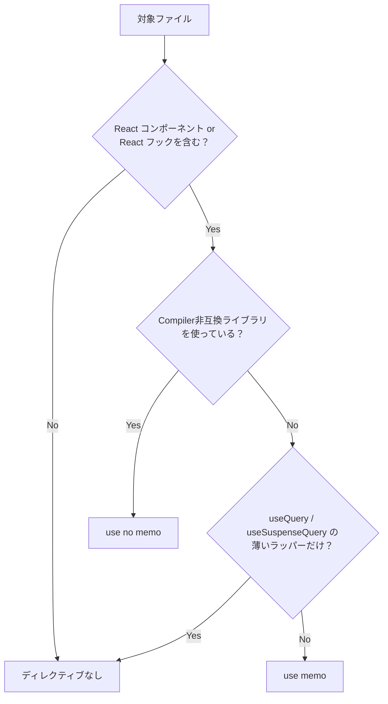
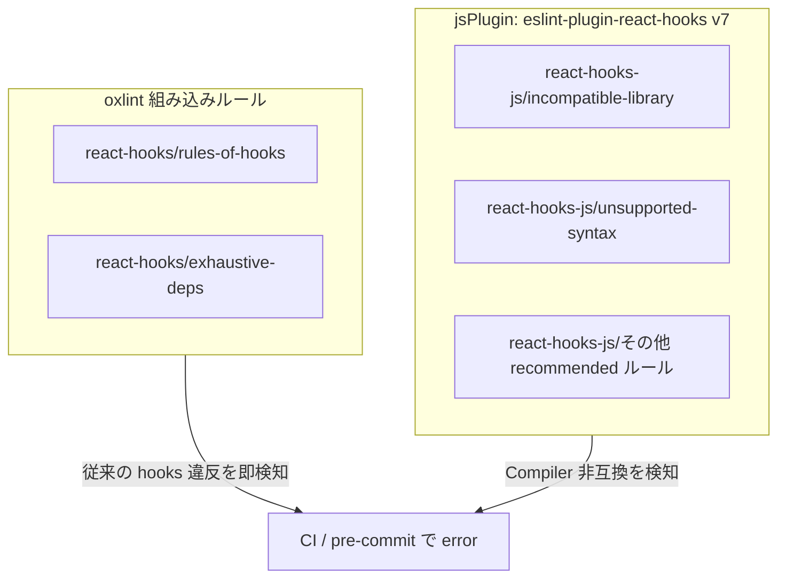

_React Compilerをannotationモードとoxlintで漸進的に導入する_

## はじめに

こんにちは。ぷーじ（[@yug1224](https://x.com/yug1224)）です。

約7,500ファイルのTypeScriptプロジェクトにReact Compilerを導入しました。annotationモードとoxlintで、`all` モードの一括適用ではなく、段階的に Compiler を広げた進め方を紹介します。

## 導入の背景

最初は `"all"` モードをローカルで気軽に試してみたのですが、TanStack Table v8を使ったテーブルが軒並み壊れ、react-hook-formのフォームが無限ループに突入し、画面が真っ白になるページも出てきました。全ファイル一括は早々に諦め、**`compilationMode: "annotation"`**（annotationモード）でファイル単位のオプトインへ切り替えることにしました。

さらに、oxlintの組み込みhooksルールと `eslint-plugin-react-hooks` v7をjsPluginとして読み込むことで、Compilerが想定しない書き方をlint段階で検知できるようにしています。oxlintのCompiler由来ルールで検出された非互換箇所は約290件に上りましたが、大半は自前コードのパターン修正で解消できるものでした。

## annotationモードとは

https://ja.react.dev/reference/react-compiler/compilationMode

https://ja.react.dev/learn/react-compiler/incremental-adoption

React Compilerは既定の `"infer"` モードでは、コンポーネントやフックと判定した関数をすべて最適化対象にします。大規模プロジェクトではそれが問題になることがあるため、[`compilationMode`](https://ja.react.dev/reference/react-compiler/compilationMode) で対象の選び方を切り替えられます。

| モード                  | 挙動                                                                                             |
| ----------------------- | ------------------------------------------------------------------------------------------------ |
| `"infer"`（デフォルト） | コンポーネント・フックらしい名前で、JSX を返すかフックを呼ぶ関数をコンパイル対象にする           |
| `"annotation"`          | 関数本体の先頭に `"use memo"` ディレクティブがあるコンポーネント・フックのみコンパイル対象にする |
| `"syntax"`              | Flow の `component` / `hook` 構文で宣言したものだけコンパイル対象にする                          |
| `"all"`                 | コンポーネント・フックに限らず、トップレベルの関数をすべてコンパイル対象にする                   |

`"infer"` モードでは、**特定ファイルをオプトアウトする手段が `"use no memo"` しかなく、「まだ検証していないファイルをデフォルトで対象外にする」ことができません**。7,500ファイルの大半が未検証の状態でスタートする今回のケースでは、「明示的にオプトインしたものだけ対象にする」annotationモードの方が安全に進められるため、inferは採用しませんでした。

annotationモードでは、関数本体の先頭に **`"use memo";`** ディレクティブを書いたコンポーネントやフックだけがCompilerの最適化対象になります。逆に **`"use no memo";`** を書くと、明示的にコンパイル対象から除外できます。

```tsx
export function UserList({ users }: Props) {
  'use memo';
  // ...
}
```

```ts
// react-compiler.config.ts
// babel-plugin-react-compiler 0.x.x 時点の設定
export const ReactCompilerConfig = {
  target: '18',
  compilationMode: 'annotation',
} as const;
```

React Compilerは React 19 で最適に動作しますが、[React 17 および 18 もサポートしています](https://ja.react.dev/learn/react-compiler/installation)。`target` にはプロジェクトの React バージョンを指定します。React 19 未満の環境でも Compiler の恩恵を受けられるのは嬉しいですね。ただし、`target` に `'17'` か `'18'` を指定するときは、`react-compiler-runtime` パッケージも依存に追加する必要があります。

## Viteへの組み込み

Viteプロジェクトでは `vite-plugin-babel` を経由して `babel-plugin-react-compiler` を適用します。[React公式ドキュメント](https://react.dev/learn/react-compiler/installation#vite)では `@vitejs/plugin-react` の `babel` オプションを使う方法が第一に紹介されています。ただ、Dress Codeでは `@vitejs/plugin-react-swc` を使っているため、Babelプラグインを別途読み込む `vite-plugin-babel` を採用しました。

```ts
// vite.config.ts（該当部分の抜粋）
import babel from 'vite-plugin-babel';
import { ReactCompilerConfig } from './react-compiler.config';

export default defineConfig({
  plugins: [
    babel({
      filter: /\.[jt]sx?$/,
      babelConfig: {
        plugins: [['babel-plugin-react-compiler', ReactCompilerConfig]],
      },
    }),
    // ... other plugins
  ],
});
```

ポイントは `filter` で `.tsx` だけでなく `.ts` も対象にしている点です。カスタムフックは `.ts` で書かれることもあるため、拡張子で漏れないようにしています。

## `"use memo"` / `"use no memo"` の判断基準

annotationモードの運用で大事なのは、どのファイルにどのディレクティブを付けるかの判断基準を明確にすることです。



### `"use memo";` を付けるファイル

| 対象                                                  | 理由                                             |
| ----------------------------------------------------- | ------------------------------------------------ |
| React コンポーネント（`.tsx`）                        | Compiler のメモ化最適化の主要ターゲット          |
| JSX を返す / React の状態・副作用を扱うカスタムフック | `useMemo` / `useCallback` 相当の自動メモ化の対象 |

### ディレクティブを付けないファイル

| 対象                                                         | 理由                                                     |
| ------------------------------------------------------------ | -------------------------------------------------------- |
| 型定義のみのファイル                                         | コンパイル対象になるコードがない                         |
| 純粋関数ユーティリティ                                       | Reactのフックを使わないためCompilerの対象外              |
| Queryフックの薄いラッパー（`useQuery` / `useSuspenseQuery`） | TanStack Queryがメモ化を管理しておりCompilerの介入は不要 |
| 定数・設定ファイル                                           | ランタイムでReactの仕組みを使わない                      |

### `"use no memo";` を付けるファイル

https://github.com/TanStack/table/issues/5567
https://github.com/react-hook-form/react-hook-form/issues/12298

一部のライブラリは React Compiler と互換性がありません。これらを使うファイルでは `"use no memo";` で明示的にオプトアウトします。

| ライブラリ                           | 理由                                                                                                                                           |
| ------------------------------------ | ---------------------------------------------------------------------------------------------------------------------------------------------- |
| `useReactTable`（TanStack Table v8） | カラム定義の変更がテーブルに反映されず、ソートやフィルタが無応答になる（[TanStack/table#5567](https://github.com/TanStack/table/issues/5567)） |
| `react-hook-form`                    | バリデーション発火時に無限ループが発生する（[react-hook-form#12298](https://github.com/react-hook-form/react-hook-form/issues/12298)）         |

`"use no memo";` を付けたファイルでも、Compiler由来のlintルールは引き続き発火します。ファイル先頭でルールを列挙する方式は禁止しており、違反箇所には **違反行の直前に** `// oxlint-disable-next-line react-hooks-js/<rule>` を付けて抑制します。

## oxlintでのlint戦略

https://oxc.rs/docs/guide/usage/linter/js-plugins

https://react.dev/reference/eslint-plugin-react-hooks

annotation 運用（`"use memo"` / `"use no memo"` の切り分け）と従来の `rules-of-hooks` / `exhaustive-deps` だけでは、Compiler 非互換を拾いきれません。そこで、oxlint の2系統運用で CI 段階のうちに Compiler 非互換を先に見つけて直す構成をとっています。

Compiler導入の初期に痛い目を見ました。CIは通っているのに、実際に動かすとテーブルのソートが反応しない。前述のlintだけではこの手の不具合を事前に検知できませんでした。

React公式の [`eslint-plugin-react-hooks`](https://react.dev/reference/eslint-plugin-react-hooks) v7にはCompiler由来の検出ルール（`incompatible-library` / `unsupported-syntax` 等）が統合されています。oxlintにはESLintプラグインをそのまま読み込める[jsPlugin](https://oxc.rs/docs/guide/usage/linter/js-plugins)という仕組みがあるため、これを使って CI 上で主要な非互換を先に検知し、既知パターンのランタイム不具合を減らしています。

具体的には、oxlintで2系統のhooksルールを運用しています。組み込みルールで従来のhooks違反を、jsPluginでCompiler固有の違反を検知する構成です。

### 2系統のルール構成



### 実際の検出例

jsPluginで検出される `incompatible-library` のエラー出力例です。

```
  × eslint-plugin-react-hooks(react-hooks-js/incompatible-library):
  │ Use of incompatible library
  │ This API returns functions which cannot be memoized ...（以下略）
  ╭─[src/features/users/UserTable.tsx:12:1]
  │
12 │ const table = useReactTable(options);
  │               ─────────────────────
  ╰─
```

このエラーが出るファイルは `"use no memo";` の付与対象です。

### 役割分担

| 系統            | プレフィックス     | 役割                                                                                                                                                   |
| --------------- | ------------------ | ------------------------------------------------------------------------------------------------------------------------------------------------------ |
| oxlint 組み込み | `react-hooks/*`    | `rules-of-hooks` と `exhaustive-deps` で従来どおりのhooksルール違反を検知                                                                              |
| jsPlugin        | `react-hooks-js/*` | `eslint-plugin-react-hooks` v7のrecommendedルールのうち、組み込みと重複しないもの。Compiler由来の `incompatible-library` / `unsupported-syntax` を含む |

### oxlint.config.ts の実装

[`eslint-plugin-react-hooks` v7のrecommendedルール](https://react.dev/reference/eslint-plugin-react-hooks)は17個に増えており、個別に定義するのは煩雑です。そこで、recommendedの設定オブジェクトからルールを動的に取得し、oxlint組み込みと重複する `rules-of-hooks` / `exhaustive-deps` を除外しています。そのうえで `react-hooks-js/*` プレフィックスへ付け替える仕組みにしました。プラグインのバージョンアップでルールが追加された場合にも自動追従できるメリットがあります。

```ts
import reactHooks from 'eslint-plugin-react-hooks';
import { defineConfig } from 'oxlint';

const BUILTIN_RULES = new Set(['rules-of-hooks', 'exhaustive-deps']);

const reactHooksJsRules = Object.fromEntries(
  Object.entries(reactHooks.configs.recommended.rules)
    // 組み込みと重複する rules-of-hooks / exhaustive-deps を除外
    .filter(([key]) => !BUILTIN_RULES.has(key.replace('react-hooks/', '')))
    // プレフィックスを react-hooks-js/* に付け替え
    .map(([key, severity]) => [key.replace('react-hooks/', 'react-hooks-js/'), severity]),
);

export default defineConfig({
  options: {
    reportUnusedDisableDirectives: 'error',
  },
  jsPlugins: [{ name: 'react-hooks-js', specifier: 'eslint-plugin-react-hooks' }],
  rules: {
    'react-hooks/rules-of-hooks': 'error',
    'react-hooks/exhaustive-deps': 'error',
    ...reactHooksJsRules,
  },
});
```

組み込みの `rules-of-hooks` / `exhaustive-deps` は `BUILTIN_RULES` として除外し、jsPlugin側では `react-hooks-js/*` プレフィックスに付け替えています。これにより、同じルールが二重に発火することを避けつつ、Compiler固有のルールだけをjsPlugin側で捕捉できます。

https://oxc.rs/docs/guide/usage/linter/config-file-reference.html#options-reportunuseddisabledirectives

[`reportUnusedDisableDirectives: "error"`](https://oxc.rs/docs/guide/usage/linter/config-file-reference.html#options-reportunuseddisabledirectives) により、不要になった `oxlint-disable` コメントが残っているとerrorになります。Compiler対応が進んで抑制が不要になったとき、コメントの消し忘れを防げるのは地味にありがたいですね。

## 7,000+ファイルへの段階適用戦略

### Phase 1: 準備（安全な境界の確立）

最初にやったのは `"use memo";` を付けることではなく、**付けてはいけないファイルを明確にすること**でした。

Compiler由来ルールで検出された非互換箇所は約290件ありました。そのうちライブラリ由来（TanStack Table v8）は15ファイル程度で、残りは自前コードのパターンでした。非互換ライブラリ（TanStack Table・react-hook-form）を使うファイルを `rg 'useReactTable|useForm' --files-with-matches` などで洗い出すと、計75ファイルありました。「思ったより多いな…」というのが正直な感想です。

これらに `"use no memo";` を一括付与してCompilerの対象外であることを明示し、並行して非互換パターンをユーティリティ関数に抽出するリファクタリングも進めました。

さらに、oxlintのCompiler由来ルールをerror化し、CIで非互換コードを確実に検知する体制を整えました。この準備があることで、以降のPhaseで `"use memo";` を付けたときに、Compiler由来ルールがカバーする範囲では、CIで主要な非互換をあらかじめ直せるようになります。ただし、ランタイム固有の状態遷移やタイミング依存の問題はlintでは検出できないため、「lintが通った＝本番でも問題ない」とは限らず、ランタイムの確認（ステージングや手動確認など）は別途必要です。

### Phase 2: 漸進的対応（`"use memo"` の拡大）

#### 新規ファイルへの適用

新規ファイルは影響範囲が読みやすいため、7,000超の既存ファイルより先に `"use memo";` の運用ルールを固めることから始めました。新規作成するコンポーネント・フックにはすべて `"use memo";` を付ける運用をチームで合意しています。

AGENTS.mdにルールを明記し、AIエージェント（Cursor / Claude Code）も同じ基準で自動付与するようにしています。エージェントがディレクティブを付与しても、**マージ前の lint と PR レビューが最終チェック** として機能するよう、CI では従来どおり error 運用を続けています。

最初の2週間で新規ファイル約140件に適用しました。

#### 既存ファイルへのボーイスカウト運用

加えて、リファクタリングや機能追加で既存ファイルを触ったら「ついでに `"use memo";` も付けておくか」というノリで付与しています。ボーイスカウトルール（触ったコードは見つけた時より綺麗にして返す）的な運用です。既存ファイルへの適用手順は以下のとおりです。

1. 対象のコンポーネント・フックの本体先頭に `"use memo";` を追加
2. `pnpm run lint` を実行
3. lintエラー（Compiler由来のルールや従来のhooksルール）が出たら修正
4. 修正が難しい場合は `"use no memo";` にフォールバック

たとえば、ステップ2でlintを回すと、描画のたびに作り直すオブジェクトを依存配列に渡す `exhaustive-deps` 違反が頻出しました。この警告は Compiler とは関係なく、従来の `exhaustive-deps` が出すものですが、あわせて解消してlintを通る状態にし、`"use memo";` を適用しています。

```diff
- const options = { page, sortKey };
- useEffect(() => { fetchData(options); }, [options]);
+ const options = useMemo(() => ({ page, sortKey }), [page, sortKey]);
+ useEffect(() => { fetchData(options); }, [options]);
```

`"use memo";` を付与してCompilerの最適化対象になれば、同等のメモ化はCompilerも行います。ただし、手書きの `useMemo` を消すと `exhaustive-deps` が同じ警告をまた出すため、この `useMemo` は残すことになります。

#### `"use no memo"` から `"use memo"` への切り替え

実際には、まずPhase 1で洗い出した非互換ファイルに `"use no memo";` を一括付与し、その後コードを修正しながら、互換になった部分から `"use memo";` に切り替えていく流れで進めています。react-hook-form周りは対象ファイルが多く、地道な作業になりました。

### Phase 3: 将来（`"all"` モードへの移行）

非互換ライブラリのCompiler対応が進み `"use no memo";` が不要になってきたタイミングで `compilationMode` を `"all"` に切り替え、ディレクティブの管理自体をなくしていく予定です。

:::message
Phase 3は今後の計画です。正直、非互換ライブラリがいつCompiler対応するかは読めていません。本記事の執筆時点ではPhase 2を進行中で、感触としては8割方いけそうだと思っていますが、残りの2割が一番厄介かもしれません。
:::

## ハマりどころとTips

### 抑制はnext-lineのみ

`"use no memo";` を付けたコンポーネントやフックでCompilerルールが発火した場合、抑制コメントは **違反行の直前の1行** にのみ書きます。

```tsx
export function UserTable({ options }: Props) {
  'use no memo';

  // oxlint-disable-next-line react-hooks-js/incompatible-library
  const table = useReactTable(options);
  // ...
}
```

行単位の `oxlint-disable-next-line` にすることで修正対象が明確になり、Compiler対応が進んで抑制が不要になったときもすぐに気づけます。

### 不要になった抑制コメントの検出

前述の `reportUnusedDisableDirectives: "error"` を設定しておけば、Compiler対応が進んで不要になった `oxlint-disable-next-line` をCIが自動で教えてくれます。設定方法は「[oxlintでのlint戦略](#oxlintでのlint戦略)」セクションを参照してください。

### AGENTS.md への記載例

AIエージェント（Cursor / Claude Code）にも同じ基準でディレクティブを付与させるため、AGENTS.md に以下のように記載しています。

```markdown
## React Compiler ディレクティブ

- 新規のコンポーネント・フックには、関数本体の先頭に `"use memo";` を付与する（ファイル先頭に書いても反映されない）
- `useReactTable` または `useForm` を使うファイルには `"use memo";` を付けない（`"use no memo";` を付与）
- 1ファイル内に Compiler 互換/非互換が混在する場合は、互換な関数の先頭に `"use memo";` を、非互換な関数の先頭に `"use no memo";` を個別に付与する
- 型定義のみ・定数・Queryフックの薄いラッパーにはディレクティブ不要
```

## まとめ

振り返ると、最初にローカルで `"all"` モードを試して盛大に壊したのが結果的によい出発点でした。壊れ方を観察したことで「何を守るべきか」が明確になり、以降の戦略が決まっていきました。

1. annotation モードでファイル単位のオプトインにすることで、全適用時のリスクを回避する
2. `"use memo"` / `"use no memo"` の判断基準を明文化し、チーム全体（AIエージェント含む）で一貫した運用を実現する
3. oxlint の2系統運用（組み込み `react-hooks/*` + jsPlugin `react-hooks-js/*`）で、従来のhooks違反とCompiler非互換の両方をlint段階で検知する
4. 段階適用（準備→漸進的対応→全適用）で、7,000超ファイルへの展開を安全に進める

最終的なゴールは `compilationMode: "all"` への移行ですが、annotationモードでの漸進的導入により、大規模な一括適用のリスクを抑えつつ、対象を絞りながらCompilerの恩恵を取り込めています。lintと段階適用で守りながら、対象範囲を広げていくのが当面の運用です。

同じように大規模プロジェクトでReact Compilerの導入を検討している方がいれば、「うちではこうハマった」「この構成でうまくいった」といった話をX（[@yug1224](https://x.com/yug1224)）で聞けると助かります。
