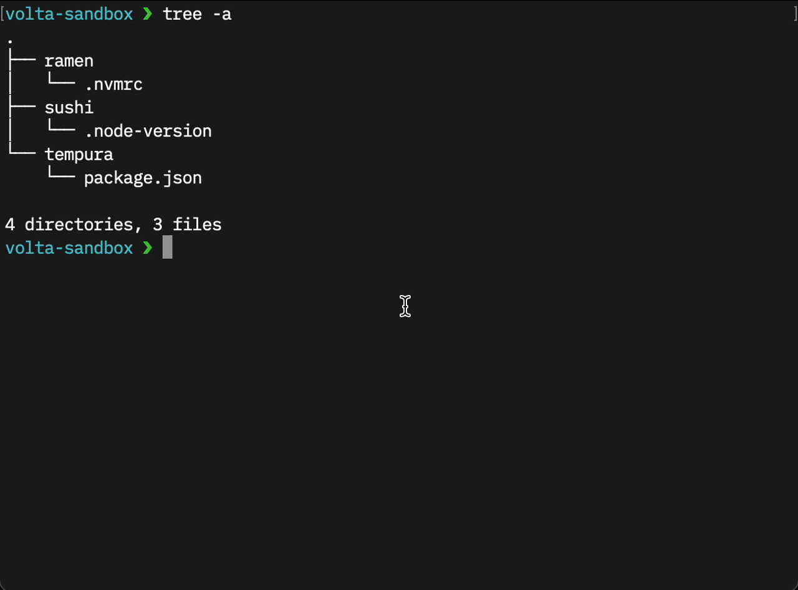

## はじめに

こんにちは。ぷーじ（[@yug1224](https://x.com/yug1224)）です。

ディレクトリ移動をするとNode.jsのバージョンを自動で切り替えてくれるバージョンマネージャーの存在って嬉しいですよね。

私はRust製の[Volta](https://volta.sh/)を使っているのですが……

「Voltaでも`.node-version`や`.nvmrc`を使ってNode.jsのバージョン切り替えがしたい！」

「でもチームメンバーはVoltaを使っていないので`package.json`を汚染するのはいやだ！」

そう思ったことはありませんか？

https://github.com/volta-cli/volta/issues/282

https://github.com/volta-cli/volta/issues/983

しかし、以前からIssueに上がっている通り、残念ながらVoltaでは`.node-version`や`.nvmrc`を使ったバージョン切り替えに対応していません。

対応していないなら自分で対応してしまえ！！

ということで、`chpwd`を使って`.node-version`や`.nvmrc`があれば、VoltaでもNode.jsのバージョンが切り替わるようにしてみました。

## chpwdを使って.node-versionや.nvmrcを読み込む

できあがったコードは以下のとおりです。自身の`.zshrc`に追記してみてください。

ディレクトリ移動をフックして処理を実行するzshの`chpwd`を利用し、`.node-version`や`.nvmrc`の設定値に応じて`volta install`の実行の仕方を調整しています。なお、`volta install`はVoltaのユーザー全体のデフォルトバージョンを更新するので、バージョン指定のない別ディレクトリや別ターミナルのNode.jsも切り替わる点に注意が必要です。また、カレントや親ディレクトリの`package.json`に`volta.node`が定義されている場合はそちらが優先されます。

```sh:.zshrc
autoload -Uz add-zsh-hook
function chpwd_volta_install() {
  # .node-versionが存在するかチェック
  if [[ -e ".node-version" ]]; then
    # .node-versionから内容を読み取る
    content=$(cat .node-version)
    volta install node@$content --quiet
  fi

  # .nvmrcが存在するかチェック
  if [[ -e ".nvmrc" ]]; then
    # .nvmrcから内容を読み取る
    content=$(cat .nvmrc)

    case $content in
    # lts/argonの場合
    "lts/argon")
      volta install node@4 --quiet
      ;;
    # lts/boronの場合
    "lts/boron")
      volta install node@6 --quiet
      ;;
    # lts/carbonの場合
    "lts/carbon")
      volta install node@8 --quiet
      ;;
    # lts/dubniumの場合
    "lts/dubnium")
      volta install node@10 --quiet
      ;;
    # lts/erbiumの場合
    "lts/erbium")
      volta install node@12 --quiet
      ;;
    # lts/fermiumの場合
    "lts/fermium")
      volta install node@14 --quiet
      ;;
    # lts/galliumの場合
    "lts/gallium")
      volta install node@16 --quiet
      ;;
    # lts/hydrogenの場合
    "lts/hydrogen")
      volta install node@18 --quiet
      ;;
    # lts/ironの場合
    "lts/iron")
      volta install node@20 --quiet
      ;;
    # lts/jodの場合
    "lts/jod")
      volta install node@22 --quiet
      ;;
    # lts/kryptonの場合
    "lts/krypton")
      volta install node@24 --quiet
      ;;
    # lts/*の場合
    "lts/*")
      volta install node@lts --quiet
      ;;
    # latest,current,node,*の場合
    "latest" | "current" | "node" | "*")
      volta install node@latest --quiet
      ;;
    # それ以外の場合
    *)
      volta install node@$content --quiet
      ;;
    esac
  fi
}
add-zsh-hook chpwd chpwd_volta_install
```

`.node-version`は良いのですが、`.nvmrc`はセマンティックバージョン以外にもLTSコードネームによる指定方法があったりしたので、意外と厄介でしたね……。新しいLTSコードネームが登場したら、`case`文に分岐を追加してください。

:::message
2026年11月追記: lts/iron・lts/jod・lts/krypton の分岐を追加しました。
:::

他にも条件がありそうな気もしますが、しばらくこれで運用してみようと思っています。



`.node-version`と`.nvmrc`と`package.json`があるディレクトリ間を実際に移動してみるとこんな感じ。

バッチリっすね。

## おわりに

zshの`chpwd`と`volta install`を組み合わせ、`.node-version`や`.nvmrc`（LTSコードネーム含む）で分岐させることで、`package.json`を書き換えずにNode.jsのバージョンを切り替えられます。Voltaを使っていて`.node-version`や`.nvmrc`があるリポジトリを行き来する方は、`.zshrc`に入れて試してみてください。

## 参考

下記の記事を参考にさせていただきました。ありがとうございました！

https://github.com/actions/setup-node

https://github.com/shadowspawn/node-version-usage

https://github.com/nvm-sh/nvm/blob/master/nvm.sh

https://zsh.sourceforge.io/Doc/Release/Functions.html

https://nodejs.org/ja/download/releases
