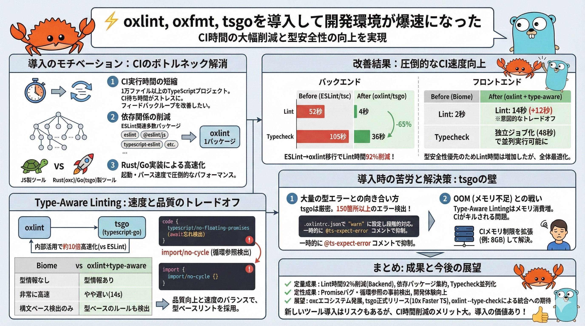

## はじめに

こんにちは。ぷーじ（[@yug1224](https://x.com/yug1224)）です。

Dress Code Advent Calendar 2025 24日目の記事です。

https://adventar.org/calendars/12017

フロントエンド・バックエンド開発で、リンター、フォーマッター、型チェッカーはコード品質を守るうえで欠かせないツールですよね。しかし、プロジェクトの規模が大きくなるにつれ、これらのツールの実行時間がCI/CDのボトルネックになることがあります。

私たちのプロジェクトは**TypeScriptファイルだけで1万ファイル以上**という規模であり、まさにこの問題に直面していました。

今回、Rust製の高速ツールチェーンであるoxc（Oxidation Compiler）と、TypeScript公式のTypeScript Native Preview（tsgo）を導入することで、CI時間を大幅に削減しました！

この記事では導入の背景、実際の改善結果、そして導入時に直面した課題と解決策について紹介します。

## 導入したツール

今回導入したツールと、置き換え対象は以下の通りです。

| 用途           | AsIs                                  | ToBe                                               |
| -------------- | ------------------------------------- | -------------------------------------------------- |
| リンター       | ESLint (backend) / Biome (frontend)   | [oxlint](https://oxc.rs/docs/guide/usage/linter)   |
| フォーマッター | Prettier (backend) / Biome (frontend) | [oxfmt](https://oxc.rs/docs/guide/usage/formatter) |
| 型チェック     | tsc                                   | [tsgo](https://github.com/microsoft/typescript-go) |

### oxc（Oxidation Compiler）とは？

[oxc](https://github.com/oxc-project/oxc/)はRustで書かれたJavaScript/TypeScript向けのツールチェーンです。パーサー、リンター、フォーマッター、トランスパイラーなどを提供しており、その高速性が特徴ですね。

https://github.com/oxc-project/oxc/

oxcは[VoidZero](https://voidzero.dev/)のプロジェクトであり、Viteの将来のバンドラーであるRolldownにも採用されています。

### TypeScript Native Preview（tsgo）とは？

tsgoはMicrosoft TypeScript公式チームが開発しているTypeScript 7（TypeScriptコンパイラのGo言語によるネイティブポート）です。従来のtscと比較して大幅な高速化を実現しています！

https://github.com/microsoft/typescript-go

https://devblogs.microsoft.com/typescript/typescript-native-port/

npmパッケージは `@typescript/native-preview` として公開されており、以下のコマンドでインストールできます。

```bash
npm install @typescript/native-preview
npx tsgo # tscと同様に使用
```

## 導入の経緯・モチベーション

導入を決めた主な理由は以下の3点です。

### 1. CI実行時間の短縮

プロジェクトの成長に伴い、リント・型チェックのCI実行時間が増加していました。特にバックエンドではCIステップ上でESLintの実行に約52秒（コマンド単体で約37秒）、型チェックに約105秒（コマンド単体で約90秒）かかっており、開発者のフィードバックループに影響を与えていました。

CI待ちの間にコーヒーを淹れて戻ってきても、まだ終わっていない…そんな経験はありませんか？私たちのチームでは、プルリクエストを出してからマージまでの待ち時間が地味にストレスになっていました。

### 2. 依存関係の削減

ESLintを使用する場合、以下のような多くの依存パッケージが必要でした。

- `eslint`
- `@eslint/eslintrc`
- `@eslint/js`
- `typescript-eslint`
- `eslint-config-prettier`
- `eslint-plugin-unused-imports`

oxlintへの移行により、これらを`oxlint`パッケージ1つに集約できました！

### 3. Rust/Go実装による高速化の恩恵

JavaScriptで実装された従来のツールと比較して、Rust（oxc）やGo（tsgo）で実装されたツールは、起動時間やパース速度で高いパフォーマンスを発揮します。

## CI速度の改善結果

実際のGitHub Actionsログから計測した改善結果です。

なお、私たちのCI環境はAWS Self-Hosted Runner（Graviton4搭載の`r8gd.2xlarge`インスタンス）で運用しています。Self-Hosted Runnerの構築についてはこちらの記事で詳しく紹介しています。

https://zenn.dev/dress_code/articles/202685fc7786da

### バックエンド

| 項目      | Before (ESLint/tsc) | After (oxlint/tsgo) | 変化     |
| --------- | ------------------- | ------------------- | -------- |
| Lint      | 52秒                | 4秒                 | **-92%** |
| Typecheck | 105秒               | 36秒                | **-65%** |

バックエンドでは**Lint時間が92%削減**という大幅な改善を達成しました！ESLintからoxlintへの移行効果が顕著に現れています。

正直、初めてCIのログを見たときは二度見しました。「え、もう終わったの？」という感覚です。

### フロントエンド

| 項目      | Before (Biome) | After (oxlint + type-aware) | 変化         |
| --------- | -------------- | --------------------------- | ------------ |
| Lint      | 2秒            | 14秒                        | +12秒（※）   |
| Typecheck | -              | 48秒                        | 独立ジョブ化 |

※ フロントエンドのLint時間が増加しているのは、`--type-aware` オプションを有効化したためです（後述）。これは意図的なトレードオフであり、型安全性を優先した結果です。

以前はBuild内でtypecheckも実行していましたが、tsgo導入に合わせてtypecheckを独立ジョブとして分離し、並列実行できるようになりました。

## Type-Aware Linting

フロントエンドのLint時間が約2秒から約14秒に増えても導入を決めたのは、oxlintのType-Aware Lintingによって型情報を使った静的解析が可能になるためです。

https://oxc.rs/blog/2025-12-08-type-aware-alpha.html

2025年12月にAlpha版として発表されたこの機能は、内部的に `tsgo` (`typescript-go`) を使うことで、ESLintと比較して約10倍の高速化を実現しています（上記記事のベンチマークより）。
現在43個のルールがサポートされており、自動修正（`--fix`）やインライン無効化コメントなどもサポートされています。

### `--type-aware` オプションの有効化

今回の移行で、oxlintの `--type-aware` オプションを有効化しました。

```json
"lint": "oxlint --tsconfig ./tsconfig.json --type-aware ./src"
```

### 以前のBiomeとの違い

| 項目           | Biome          | oxlint + type-aware |
| -------------- | -------------- | ------------------- |
| 型情報の利用   | なし           | あり                |
| 実行速度       | 高速（約2秒）  | やや遅い（約14秒）  |
| 検出可能なバグ | 構文ベースのみ | 型ベースのルールも  |

### 型ベースルールの例

`--type-aware` を有効にすることで、以下のような型情報を必要とするルールが使用可能になります。

```typescript
// typescript/no-floating-promises
// awaitされていないPromiseを検出
async function fetchData() {
  fetch('/api/data'); // ← 警告: Promise must be awaited or void
}

// typescript/no-misused-promises
// 条件式でのPromiseの誤用を検出
async function check() {
  if (fetchData()) {
    // ← 警告: Expected non-Promise value in a boolean context
    // ...
  }
}
```

### トレードオフの判断

実行時間は約12秒増えたものの、Promise関連のバグをCIで事前に防げる価値を優先し、型ベースのリントを採用しました。バックエンドではLint時間が92%削減されており、プロジェクト全体としてはCI時間の短縮に成功しています！

## 設定ファイルと実装詳細

### package.jsonのscripts設定

実際に使用しているnpm scriptsの例です。

```json
{
  "scripts": {
    "lint": "oxlint --tsconfig ./tsconfig.json --type-aware ./src",
    "format": "oxfmt --write .",
    "typecheck": "tsgo --noEmit"
  }
}
```

### oxlintの設定（.oxlintrc.json）

```json
{
  "$schema": "https://docs.oxc.rs/schemas/oxlintrc.json",
  "plugins": ["typescript", "oxc", "import"],
  "rules": {
    "eqeqeq": ["error", "always", { "null": "ignore" }],
    "no-console": ["error", { "allow": ["info", "warn", "error"] }],
    "no-debugger": "error",
    "no-unused-vars": [
      "warn",
      {
        "argsIgnorePattern": "^_",
        "varsIgnorePattern": "^_",
        "caughtErrorsIgnorePattern": "^_"
      }
    ],
    "typescript/no-floating-promises": "error",
    "typescript/no-namespace": "off",
    "import/no-cycle": "error"
  }
}
```

特に `import/no-cycle` ルールを追加することで、モジュール間の循環参照を検出できるようになりました。循環参照はバンドルサイズの増加や予期せぬ挙動の原因になるため、早期に検出できるのは嬉しいですね。

### oxfmtの設定（.oxfmtrc.json）

```json
{
  "$schema": "./node_modules/oxfmt/configuration_schema.json",
  "printWidth": 80,
  "tabWidth": 2,
  "useTabs": false,
  "semi": true,
  "singleQuote": true,
  "trailingComma": "es5",
  "endOfLine": "lf",
  "experimentalSortImports": {
    "groups": [
      ["side-effect"],
      ["builtin"],
      ["external"],
      ["internal"],
      ["parent", "sibling", "index"]
    ],
    "sortSideEffects": false,
    "newlinesBetween": false,
    "ignoreCase": true
  }
}
```

`experimentalSortImports` により、import文の自動ソートも行っています！

https://github.com/oxc-project/oxc/issues/14253

ただし、`experimental`（実験的）というプレフィックスが示す通り、コメントの配置処理などで意図しない挙動になるケースも報告されており、今後の改善に期待です。

## 導入時の苦労

スムーズに導入できたわけではありません。特にtsgoとoxlintへの移行時にはいくつかの壁がありました。

### 大量の型エラー・既存リント違反との向き合い方

tsgoは従来のtscよりも型チェックが厳密な箇所があり、oxlintのルール追加も重なって、導入時のフロントエンドでは150箇所以上の型エラーや既存リント違反が検出されました。

正直、この量を見たときは「本当に移行するの…？」と一瞬ひるみました。しかし、ここで現実的な判断として、すべてを一気に修正するのではなく段階的に対応する方針を採用しました。

```json
// .oxlintrc.json（rules の抜粋）
{
  "rules": {
    "react-hooks/rules-of-hooks": "warn"
    // NOTE: 151箇所の既存違反があるため、warn に設定。段階的に error に引き上げ予定。
  }
}
```

また、一部の型エラーについては `@ts-expect-error` コメントで一時的に抑制しています。

```typescript
// @ts-expect-error -- tsgo型推論の一時的な問題を回避
const data = someFunction();
```

この判断の理由と方針は次の3点です。

- 一度にすべてを修正しようとすると、リリースまでに時間がかかりすぎる
- まずはtsgoを導入してCI高速化のメリットを享受し、型修正は別途計画的に進める
- 既存の型エラーは `@ts-expect-error` で局所的に抑えてCIを通し、新たに入る型エラーはCIで検出できるようにし、件数の多いリントルールは `warn` 設定でCIを止めずに可視化して段階的に改善する

これは完璧を求めすぎて導入が頓挫するより、まず動かして徐々に改善するという実践的なアプローチです。将来的にはすべて `error` に引き上げる予定ですが、まずは導入のハードルを下げることを優先しました。

### OOMとの戦い

Type-Aware Lintingは型情報を解析するため、従来よりもメモリ消費が増加します。導入当初はCIがOOM（メモリ不足）でキルされる問題に悩まされました。GitHub ActionsのRunner環境およびNode.js経由で動くツールのメモリ上限（`--max-old-space-size` を含む）を8GBに拡張することで解決しましたが、この辺りは環境に合わせた調整が必要です。

## まとめ

oxlint、oxfmt、tsgoの導入により、以下の成果を達成しました！

### 定量的な成果

- リント時間（バックエンド）: 92%削減（52秒 → 4秒）
- 型チェック時間（バックエンド）: 65%削減（105秒 → 36秒）
- 型チェック（フロントエンド）: 独立ジョブ化により48秒で完了（並列実行可能に）
- 依存パッケージ: ESLint関連6パッケージ → oxlint 1パッケージ

※ フロントエンドのLint時間は `--type-aware` 有効化により2秒→14秒に増加していますが、これは型安全性向上のための意図的なトレードオフです。
※ Type-Aware Lintingは型情報を解析するためメモリ使用量が増加する傾向にあり、導入時にはCIのRunnerのメモリやNode.jsのヒープ上限（`--max-old-space-size`）の調整が必要になる点に注意が必要です。
※ 本記事で使用したバージョン: tsgo `7.0.0-dev.20251130.1`, oxlint `1.31.0`, oxfmt `0.16.0`

### 定性的な成果

- 型ベースのリントルールにより、Promise関連のバグを事前に検出可能に
- `import/no-cycle` ルールによる循環参照の検出
- 開発者のフィードバックループの短縮

### 今後の展望

oxcのツール群は急速に発展しており、今後さらなる機能追加や安定性の向上が期待されます。また、tsgoもまだプレビュー版ですが、TypeScript公式チームが開発を進めており、将来的にはtscの完全な代替となる可能性がありますね。

2025年3月、TypeScript開発者のAnders Hejlsberg氏が「A 10x Faster TypeScript」を発表し、tsgoの存在が広く知られるようになりました。VS Codeのような150万行規模のコードベースでも約10倍の高速化を実現しているとのことで、今後の正式リリースが楽しみです。

さらに、oxlintでは `--type-check` フラグによる型チェック機能も実験的にサポートされています。Type-Aware Lintingで既に型情報を解析しているため、その情報を再利用して型チェックも同時に行えるという仕組みです。将来的には `oxlint --type-aware --type-check` 一発でリントと型チェックを完結できるようになるかもしれません。

新しいツールの導入には一定のリスクがありますが、CI時間の削減という明確なメリットがあり、導入する価値は十分にあると感じています！
