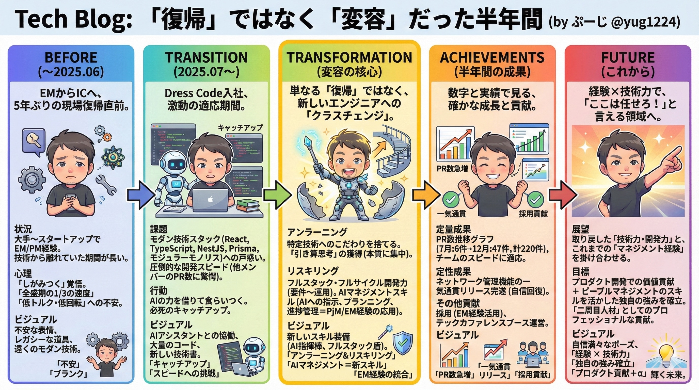

## はじめに

こんにちは。ぷーじ（[@yug1224](https://x.com/yug1224)）です。

「エンジニア転職Advent Calendar 2025」24日目の記事です。

https://adventar.org/calendars/11370

2025年7月にDress Code株式会社へジョインし、気づけば今月でもう半年。入社1か月時点で書いた振り返り記事では、こんなことを書いていました。

> **全盛期の3分の1程度の速度しか出せない**悔しさを感じつつも、AIの力でなんとか食らいついています。
> 現在はまだ低トルク・低回転の状態なので、一刻も早く高トルクに上げて馬力を取り戻したいです。

https://zenn.dev/dress_code/articles/be0aaf9be396a4

あれから5か月が経ち、**私は「復帰」したのではなく「変容」した**と感じています。

昔と同じ場所に戻ってきたのではなく、AIを使って爆速で開発を進めていく「新しい現場」で、別のスキルセットを身につけた感覚です。

この記事ではスタートアップへの転職を考えている方、EMからICへの転身やブランクを経て開発現場に戻ろうとしている方に向けて、私のこの半年間の経験を共有します。

## 1か月時点の振り返り

### 当時の状況

入社1か月時点では正直なところ「しがみついている」状態でした。

- 5年以上現場から離れていた不安
- モダンな技術スタックへの戸惑い
- チームの開発スピードについていけるか

1か月記事で「低トルク・低回転」と表現した通り、エンジニアとしての感覚を取り戻すのに必死でした。

### 半年後の今

では、あれから何が変わったのか。

「帰ってきた」という感覚もありますが、それ以上に5年前とは違う自分になったという実感の方が強いです。

螺旋階段を上るように、平面で見れば同じ「IC」に戻ったように見えます。でも高さで見ると、EM時代の経験が積み重なって、違う場所にいる。これが「復帰」ではなく「変容」と感じる理由です。

## 半年間の個人的な成果

### 数字で振り返る

| YYYY/MM | Pull Request |
| ------- | -----------: |
| 2025/07 |          6件 |
| 2025/08 |         29件 |
| 2025/09 |         51件 |
| 2025/10 |         50件 |
| 2025/11 |         37件 |
| 2025/12 |         47件 |
| 合計    |        220件 |

※ 2025年7月1日〜12月時点のデータ（GitHub MCPツールにて集計）

弊社チームメンバーが書いた記事によると、Dress Codeでは1年間でリポジトリ規模が合計約130万行に成長し、年間3,900件以上のPRがマージされているそうです。

https://zenn.dev/dress_code/articles/7c2aa029d1ca00

この速い開発ペースの中で振り落とされず、ついていけるようになったのは大きな成長でした。

### やりきったと感じた瞬間

フロントエンドからバックエンドまで一気通貫でプロダクトリリースをやりきった時、ようやく「人並みに成果を出せるようになった」と感じました。

具体的には、2025年10月にリリースした「ネットワーク管理/Networks」のプロダクト開発を担当しました。

https://prtimes.jp/main/html/rd/p/000000014.000160565.html

今見ると改善したいところがたくさんありますが、リリースまで持っていけたこと、チームのスピードに追いつけたこと、他のメンバーのフォローなく完遂できたことが自信につながりました。

## アンラーニングとリスキリング

成果を出せるようになった一方で、アンラーニングとリスキリングが進んで、以前とは別のスキルセットになったという感覚があります。

### 手放したもの

以前の私は、特定の技術スタック（フロントエンドなど）に専門性を持つことにこだわっていました。

しかし、Dress Codeではフルスタック・フルサイクルなプロダクト開発が求められます。フロントエンドもバックエンドもインフラも、必要なら何でもやる。

最初は戸惑いましたが、この環境に身を置くことで、特定の技術スタックへのこだわりは自然と薄れていきました。

### 獲得したもの

#### 1. フルスタック・フルサイクル開発力

これまでも要件定義から運用保守まで一気通貫の経験はありました。ただ、どこかで「フロントエンド特化」という意識があったのも事実です。

今は**顧客の課題を解決する価値を届けるために、必要なことは何でも自分たちでやる**というマインドセットに変わっています。

#### 2. 引き算思考

Dress Codeの開発哲学に「引き算思考」があります。

全体像を想定しきってから、今何をやるか、どんな順序で登っていくかを考える。余計なものを削ぎ落として、やるべきことに集中する。

この思想は「アーキテクチャの理想」としても言葉にされており、開発生産性カンファレンス2025で河村さんが発表しています。

https://findy-tools.io/articles/dresscode-dev-productivity-con-2025/129

https://speakerdeck.com/anizozina/sutatoatupukosoquan-yuan-de-platform-engineering-supidotochi-sok-xing-woliang-li-suruwen-hua-nozuo-rifang

理想を明確にすることで目指す方向が見え、引き算で思考できる。私たちの現場のように少人数かつ高速で開発を進める環境では、この考え方が特に活きると感じています。

#### 3. AIマネジメントスキル

これが一番大きな変化です。

AIを使った開発では単に「AIにコードを書かせる」のではなく、**AIをマネジメントしながら開発を進める**という新しいスキルが求められます。

いきなり抽象的な指示を出さず、まず設計方針のすり合わせ（プランニング）から始める。そのうえで「スキーマ定義→ユースケース実装→画面つなぎ込み」のようにPRやステップ単位へ細かく分解して指示し、1ステップごとに出力を確認しながら進める。

私の場合、AIをマネジメントしながら開発する感覚は、プロジェクトマネジメントに近いと感じています。PjMやEM時代の経験が、思わぬ形で活きています。

## 苦労したこと

### モダン技術スタックへの適応

B2B SaaSの経験が長かったので、ドメイン知識のキャッチアップではあまり躓きませんでした。

しかし、しばらく現場から離れていたので、モダンな技術スタックで作られたシステムの理解には苦労しました。

Dress CodeではReact・TanStack・NestJS・Prisma・TypeScriptをベースに、AWS上で戦術的DDDを意識したモジュラーモノリス構成で開発しています。

https://zenn.dev/dress_code/articles/252e90c8fd5c31

個人開発で技術には触れ続けていたし、トレンドも追いかけていました。それでも、これらが組み合わさった実務レベルのシステム理解には、やはり時間がかかりました。

### 周囲の開発スピード

入社当初、PRのレビュー依頼が来るスピードに驚きました。自分が1つのPRを出す間に、チームメンバーは3つも4つもマージしている。

今ではもう慣れましたが、最初は「振り落とされないようにしがみつく」という表現がぴったりでした。

## 開発以外での貢献

開発だけでなく、これまでの経験を活かした貢献もできています。

### 採用活動

カジュアル面談や面接の対応も担当しています。EM時代に年間300件以上の面談・面接を経験していたので、この部分では即戦力として貢献できていると感じています。

### テックカンファレンスでのブース運営

SRE NEXT 2025など、テックカンファレンスでのスポンサーブース運営にも参加しました。入社直後からこうした活動に関われるのは、スタートアップならではですね。

## これから

### 経験×技術力

この半年は自信と技術力を取り戻す期間でした。

今後はこれまでの経験と、取り戻した技術力・開発力を掛け合わせて成果を出していきたいと考えています。

### 「ここは任せろ！」と言える領域

Dress Codeには「二周目人材」が多いです。別の会社でリードやマネジメントの経験を積んできた、いわばプロフェッショナル集団。

https://biz-journal.jp/company/post_390402.html

その中で、「ここは任せろ！」と自他ともに認める領域を確立したい。

自分としては、プロダクト開発で価値貢献しつつ、**ピープルマネジメントをかけ合わせた領域**で力を発揮していきたいと考えています。EMからICに転身したとはいえ、マネジメント経験は自分の強みの1つ。開発力を取り戻した今だからこそ、その経験を活かせる場面もあるのではと思っています。

## おわりに

5年以上現場から離れていた私が、開発現場に戻った半年間。

それは単なる「復帰」ではなく、AIをマネジメントしながら開発するという新しいスタイルへの「変容」でした。RPGで例えるなら、同じ職業に戻る「ジョブチェンジ」ではなく、IC時代の開発力とEM時代のマネジメント経験を統合した「クラスチェンジ」です。

もしEMからICへの転身を考えていたり、ブランクを経て開発現場に戻ろうとしているなら、伝えたいことがあります。必ずしも昔と同じに戻る必要はありません。AIという心強いパートナーと共に、新しいエンジニアとして「変容」する道もあります！

本記事が同じような道を歩もうとしている方の背中を押せたなら嬉しいです。
