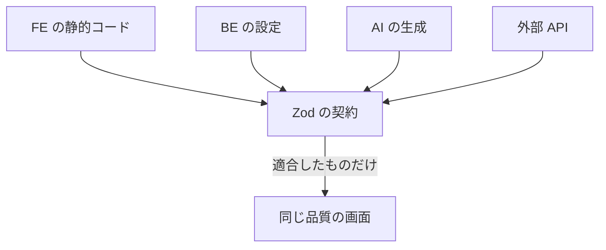
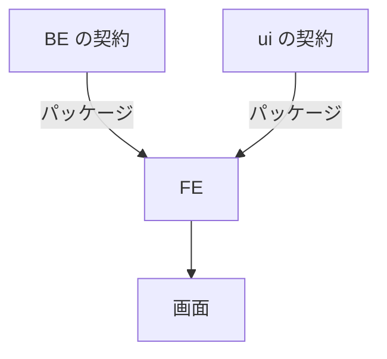

## はじめに

こんにちは。ぷーじ（[@yug1224](https://x.com/yug1224)）です。

2026 年 10 月 24 日の Vue Fes Japan 2026 で、「契約で守るコンパウンドプロダクトのデザインシステム」というタイトルで登壇しました。この記事は、その発表の内容がもとになっています。

https://vuefes.jp/2026/speaker/yug1224

@[speakerdeck](9de83bc11e6c4f948216301186bd6e97)

当日のブースや登壇の様子は Dress Code の note にまとまっているので、あわせてご覧ください。

https://note.com/dresscode/n/n3ac7b5bb4ab0

Dress Code ではデザインシステムの dresscode-ui を Schema-Driven UI（SDUI）として作っています。画面の仕様は Zod で書いた契約で決まり、バックエンド（dresscode-backend）の API も Zod の契約で定義しています。

フロントエンド（dresscode-frontend）は、この 2 つの契約を受け取って画面を作ります。たとえば AI チャットの画面では、dresscode-backend から受け取った会話を dresscode-ui の契約に合う形に写し、dresscode-ui の部品で描画しています。

登壇では dresscode-ui の契約を中心に話しました。この記事では、dresscode-ui と dresscode-backend が Zod で契約をどう書いているかと、dresscode-frontend が 2 つの契約を受け取るときに、ずれをテストで検知する方法を紹介します。

以降は dresscode-backend を BE、dresscode-frontend を FE、dresscode-ui を ui と略します。

## Schema-Driven UI とは

SDUI は、一般には Server-Driven UI の略として使われることが多い言葉です。サーバーが画面の定義を JSON で返し、クライアントがそれを描画する方式を指します。

私たちのチームでは SDUI を Schema-Driven UI と読んでいます。画面の定義がどこから来るかを並べると、サーバーは入口の 1 つにすぎないからです。



どの入口から来た定義でも、同じ契約に適合していれば同じ画面が出ます。私たちはこの性質を author-agnostic（作者に依存しない）と呼んでいます。Server-Driven は配信経路の名前で、Schema-Driven は契約の名前です。React のコンポーネントは契約を描画する手段の 1 つで、私たちがバージョンを管理してテストする本体は契約のほうです。

## dresscode-ui を誰がどう作っているか

dresscode-ui には、専任のデザインシステムチームがいません。プロダクト開発の中で、PdM と PdE（プロダクトエンジニア）が開発から運用・保守までを受け持っています。

dresscode-ui では使えるものをあえて制限しています。AI が作っても人が作っても、画面を増やしていくと見た目や振る舞いは少しずつずれていきます。制限をかけるのは、このずれを抑えて、誰が作っても同じ UI になるようにするためです。

この考え方は AI にデザインを任せるときの品質の守り方として広まっている「デザインハーネス」や「Agentic Design System」と同じです。デザインハーネスは制約・文脈・検証・評価の 4 層で AI の生成を導く考え方です。

https://note.com/kgsi/n/n707d989e1a44

Agentic Design System は、AI エージェントが読むだけでなく、必要な情報を問い合わせて使えるように作ったデザインシステムを指します。

https://www.supernova.io/blog/what-is-an-agentic-design-system

私たちの理解では、この 2 つが主に扱うのは見た目とコンポーネントの使い方です。デザインハーネスは状態の抜けも検証の対象にしますが、操作したときに何が起きるかは人の判断に残しています。Agentic Design System も、コンポーネントの状態の一覧までは扱うものの、操作の結果を定める部分は扱っていません。

dresscode-ui では制限を 2 つの層でかけています。

| 層       | 制限するもの                             | 確かめる手段       |
| -------- | ---------------------------------------- | ------------------ |
| 見た目   | トークン、コンポーネント、依存の向き     | 構造テスト、VRT    |
| 振る舞い | 操作の結果、失敗の種類、未知の画面の扱い | Zod の契約のテスト |

VRT はビジュアルリグレッションテスト（画面のスクリーンショットの差分を見るテスト）です。

見た目の層はデザインハーネスの守備範囲とほぼ重なります。振る舞いの層まで契約で決めているのが dresscode-ui の特徴で、この記事で扱う Zod の契約はこちらの層の話です。

## dresscode-ui の契約で制限していること

### 操作の結果を決まった値で表す

たとえば AI チャットでは、利用者の操作をアプリ側が受け付けたかどうかを、次の形で返すと契約で決めています。

```ts
export const actionResult = z.discriminatedUnion('status', [
  z.object({ status: z.literal('accepted') }),
  z.object({
    status: z.literal('rejected'),
    rejection: z.object({
      kind: z.union([z.enum(['busy', 'conflict', 'invalid', 'unavailable']), z.string()]),
      message: z.union([z.string(), z.null()]),
    }),
  }),
]);
```

`kind` は、決まった値の一覧に加えて、未知の文字列も受け付ける形です。BE 側で値が増えても parse は落ちず、UI は未知の値を決まった種類として扱います。UI が `message` の文字列で分岐しないことも決まりです。失敗（`{ kind, retryable, message }`）や、問いへの答え（`accept` / `decline` / `cancel` の 3 つ）も同じ考え方で契約にしています。

会話の中に知らない種類の画面が届いたときも、会話全体の parse は落とさず、代わりの表示で描くと決めています。

### JSON Schema に変換できる形だけで書く

BE や AI は契約を JSON Schema として読みます。そのため契約の中では JSON Schema に変換できない `z.date()` や `.transform()` を使いません。値がないことも、`.optional()` で省略するのではなく `z.union([x, z.null()])` で null として表す決まりです。

変換できない書き方が紛れ込んでいないかは、すべての契約を [`z.toJSONSchema()`](https://zod.dev/json-schema) に通すテストで確かめています。

```ts
it('すべての契約を JSON Schema に変換できる', () => {
  const failures = [];
  for (const [name, schema] of schemas) {
    for (const io of ['input', 'output'] as const) {
      try {
        z.toJSONSchema(schema, { io });
      } catch (error) {
        failures.push({ export: name, io, reason: String(error) });
      }
    }
  }
  expect(failures).toEqual([]);
});
```

### 受け取った定義は必ず検証する

画面の定義は `protocolVersion` と出自（human / server / ai）を付けた共通の形式で受け渡します。dresscode-ui の部品が自分で定義を取得するときは、この形式ごと `safeParse` してから描画します。取得に失敗したのか、契約に合わなかったのかを区別して返し、形の崩れた定義を空の画面として表示することはしません。

出自は記録するだけで、出自によって描画や検証の処理を変えないことも、テストで機械的に検査しています。

## 3 つのリポジトリで Zod の役割はどう違うか

Zod を使っているのは dresscode-ui だけではありません。3 つのリポジトリとも Zod 4 で書いていますが、役割はそれぞれ違います。

| リポジトリ         | Zod の主な役割                                                                                                            |
| ------------------ | ------------------------------------------------------------------------------------------------------------------------- |
| dresscode-backend  | API の契約の大元。[oRPC](https://orpc.unnoq.com/) の契約を Zod で書き、実装を契約に合わせ、契約をパッケージにして公開する |
| dresscode-ui       | 画面仕様の契約。AI が作った定義の検証にも同じ契約を使う                                                                   |
| dresscode-frontend | 2 つの契約を受け取る側。ほかにルートの検索パラメータ、フォーム、エラーメッセージの多言語化にも使う                        |

dresscode-frontend から見ると、契約は 2 方向から届きます。



## dresscode-frontend で契約のずれを止めている場所

dresscode-frontend が契約を受け取る経路ごとに、ずれを止める仕組みを並べると次のとおりです。

| 経路                                   | ずれを止める仕組み                                                                   |
| -------------------------------------- | ------------------------------------------------------------------------------------ |
| BE の実装と BE の契約                  | 型チェック（実装を契約に合わせて書くため）                                           |
| BE の契約と、FE が使うパッケージの契約 | 同じ契約から作るのでずれない。ただし FE が古いバージョンを使っていれば、その分ずれる |
| 実行時の BE のレスポンス               | なし（FE はレスポンスを検証していない）                                              |

BE の契約と ui の契約が FE で合流するのは、BE から受け取ったデータを ui の契約に合う形に写す変換関数です。ここでは AI チャットの会話を写す関数を例にします。この関数の入力と出力は型チェックを通っていました。ただ、型が合っていても、BE の Zod が持つ制約（enum の値、省略できる項目、空配列）に合う値かどうかは確かめていませんでした。

## 変換関数のテストを両側の Zod で挟む

### Before

変換関数のテストは入力に型を付けた手書きのオブジェクトを使っていました。型は合っていても、BE の Zod が許す値かどうかは確かめていません。

```ts
const question: ChatMessage = {
  messageId: 'm-1',
  role: 'user',
  content: '有給の申請方法は？',
  timestamp: '2026-10-05T10:00:00.000Z',
};

// 出力が ui の契約に合うか
expect(chatSession.safeParse(session).success).toBe(true);
```

### After

入力を BE の契約で parse してから使い、出力を ui の契約で検証するようにしました。パッケージ名と一部の型名は、仮のものに置き換えています。

```ts
import { SessionDetailSchema } from 'backend-contract';
import { chatSession } from 'ui-contract';

const beMessageSchema = SessionDetailSchema.shape.messages.element;

/** BE の契約に合わない発言は、入力に使う前に落とす */
const validMessage = (message: ChatMessage): ChatMessage => {
  beMessageSchema.parse(message);
  return message;
};

const question = validMessage({
  messageId: 'm-1',
  role: 'user',
  content: '有給の申請方法は？',
  timestamp: '2026-10-05T10:00:00.000Z',
});

// 失敗時に issue が出るよう error を見る
expect(chatSession.safeParse(session).error).toBeUndefined();
```

`validMessage` は、parse の戻り値ではなく元の値を返します。FE の `ChatMessage` 型は契約にない項目も持っていて、parse の戻り値を使うとその型が崩れるためです。

出力の検証は `.success` を `true` と比べる書き方から、`.error` が `undefined` かを見る書き方に変えました。テストが落ちたとき、どの項目が契約に合わないかがテストの結果に出ます。

### BE の契約が許す範囲の端を確かめる

ずれが出やすいのは、省略や空を許す項目です。そこで、BE の契約が許す端の値でテストを書きました。

```ts
// BE の契約で省略できる項目と、空にできる項目
it.each<[string, Partial<ChatMessage>]>([
  ['出典が空配列', { citations: [] }],
  ['出典が本文だけ', { citations: [{ content: 'chunk-a' }] }],
  ['出典の metadata が空', { citations: [{ content: 'chunk-a', metadata: {} }] }],
  ['回答できなかった', { canAnswer: false }],
])('BE の契約に合う発言（%s）を ui の契約に合う会話にする', (_, patch) => {
  const view = buildChatSession([question, answer(patch)]);
  expectValidSession(view);
});
```

テストは既存のものと合わせて 21 件がすべて通り、手書きだった入力が今の BE の契約に合っていたことも確かめられました。

## 何を検知して、何を許容したか

このテストで検知できるのは、パッケージのバージョンを上げる PR の中です。検知できるものとできないものを表にしました。

| ずれ                                              | 検知する手段                                    | 検知するタイミング                     |
| ------------------------------------------------- | ----------------------------------------------- | -------------------------------------- |
| BE の契約の項目名・型の変更                       | 型チェック、入力を BE の契約で parse するテスト | BE の契約のバージョンを上げる PR       |
| ui の契約の変更                                   | 型チェック、出力を ui の契約で検証するテスト    | ui の契約のバージョンを上げる PR       |
| 稼働中の BE が、FE の使うバージョンより先に変わる | なし                                            | 次に BE の契約のバージョンを上げたとき |
| 契約にない項目（出典のタイトルなど）の名前の変更  | なし（許容する）                                | なし                                   |

稼働中の BE が先に変わった場合は、FE がバージョンを上げるまで気付けません。これを実行時に検知するには、レスポンスを検証する必要があります。

oRPC にはレスポンスを検証するプラグインがありますが、違反すると例外を投げるので、画面が止まります。記録だけにするなら、`safeParse` してログに送る処理と、ログを見張る監視の設定まで要ります。今のところは手間に見合わないと判断して、実行時の検証は見送りました。

この判断と、変換関数のテストの書き方はリポジトリのドキュメントに残しました。BE の API を呼ぶ作業で AI エージェントが読むスキルからも参照させて、バージョンを上げる作業の途中で気付けるようにしています。

## おわりに

私たちのチームでは dresscode-ui の本体を Zod の契約と考え、見た目だけでなく振る舞いまで契約で制限しています。契約が 2 つあるなら、ずれが起きるのは 2 つが合流する場所です。その場所を両側の Zod でテストに挟むと、バージョンを上げる PR でずれが落ちるようになりました。

一方で、全部を検知しようとはしていません。稼働中の BE が先に変わる場合と、契約にない項目の変更は、検知しないと決めて表に残しました。

ほかの画面で変換関数を書くときも、同じテストを置く予定です。

最後まで読んでいただき、ありがとうございました。

## 参考文献

- [What is Design Harness｜こぎそ](https://note.com/kgsi/n/n707d989e1a44)
- [AIエージェントのUI品質を守る4層の運用基盤 - Design Harness](https://zenn.dev/suwash/articles/design-harness_20260805)
- [デザインハーネス入門｜デザペディア](https://www.ds-pedia.com/2026/06/29/design-harness/)
- [What Is an Agentic Design System? A Practical Definition｜Supernova](https://www.supernova.io/blog/what-is-an-agentic-design-system)
- [Agentic Design Systems: The Complete Guide｜Into Design Systems](https://www.intodesignsystems.com/agentic-design-systems)
- [Agentic design system: how to build a component library AI agents can actually use｜TDP](https://designproject.io/blog/agentic-design-system/)
- [JSON Schema｜Zod](https://zod.dev/json-schema)
- [oRPC](https://orpc.unnoq.com/)
